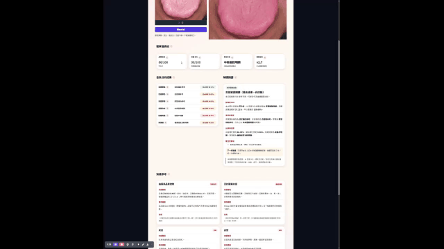
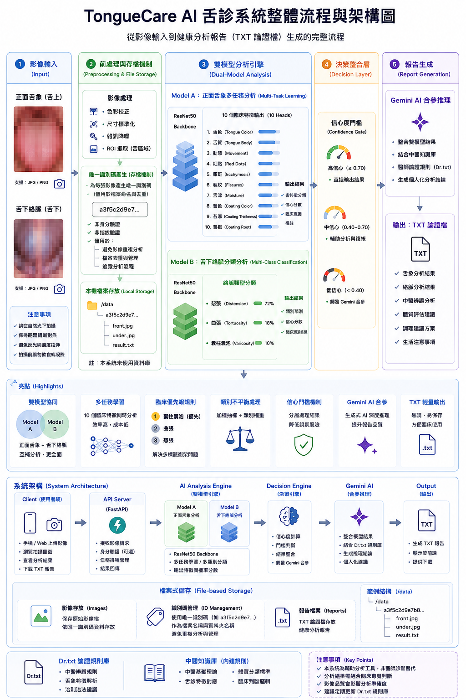
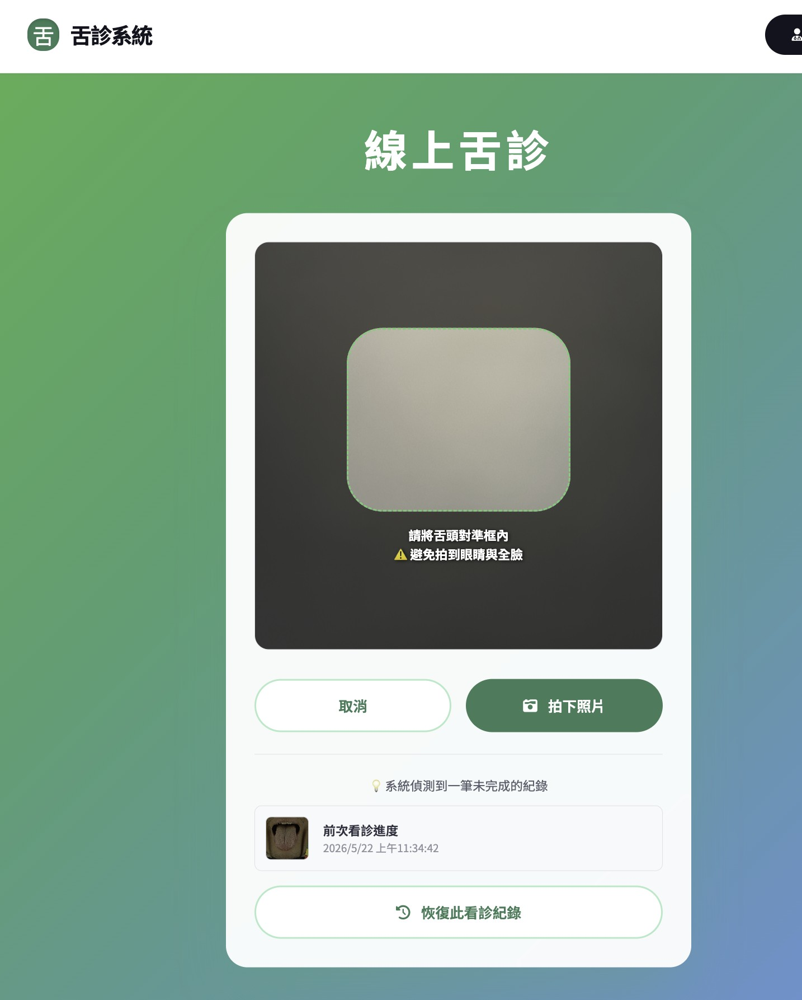
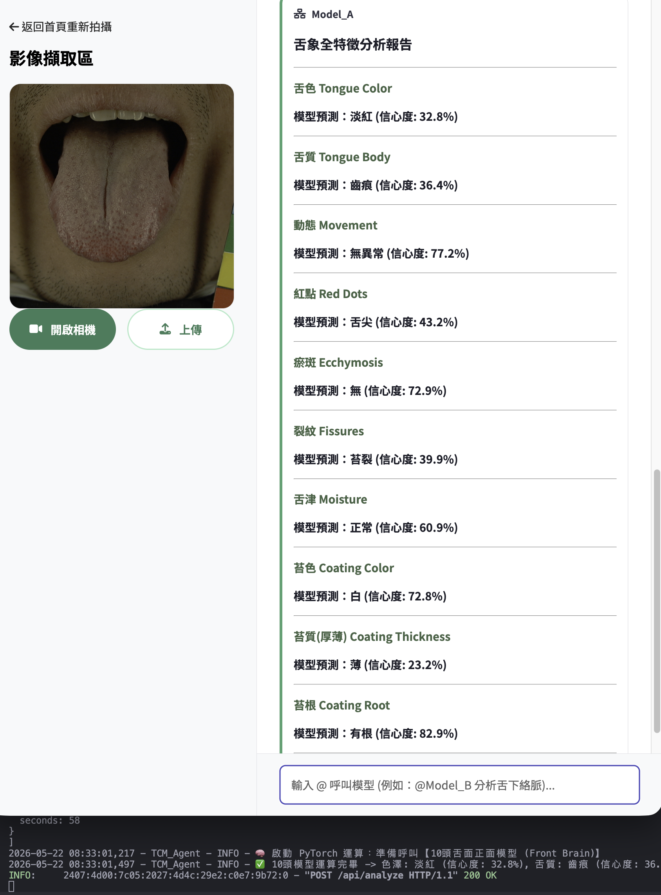
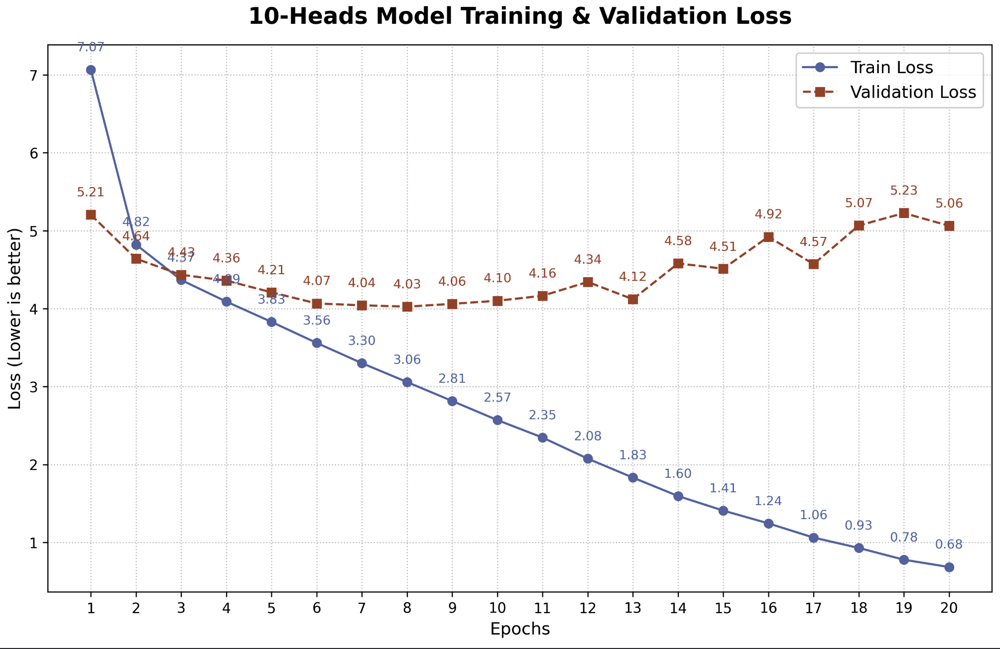
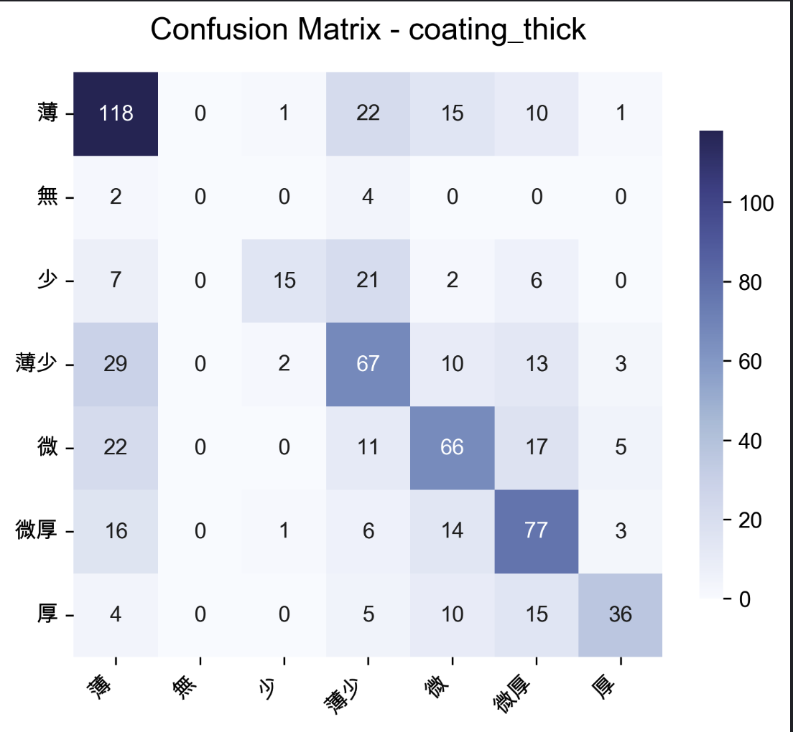
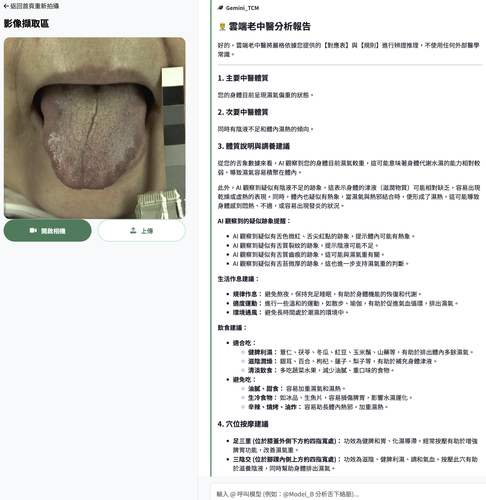
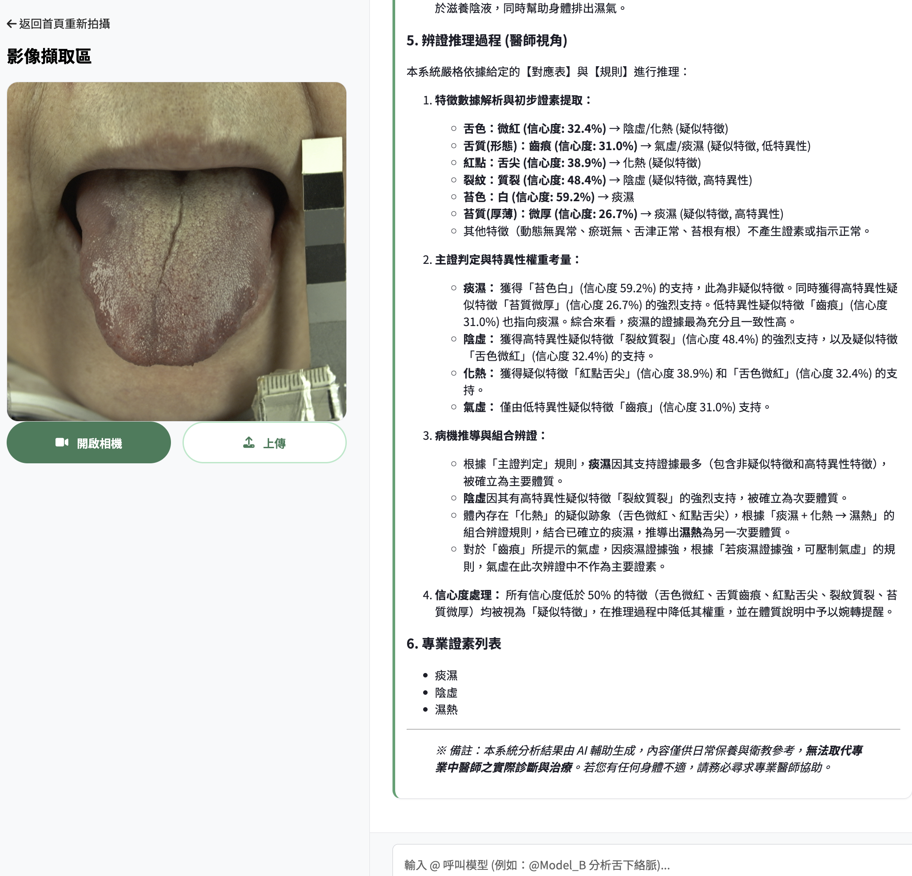
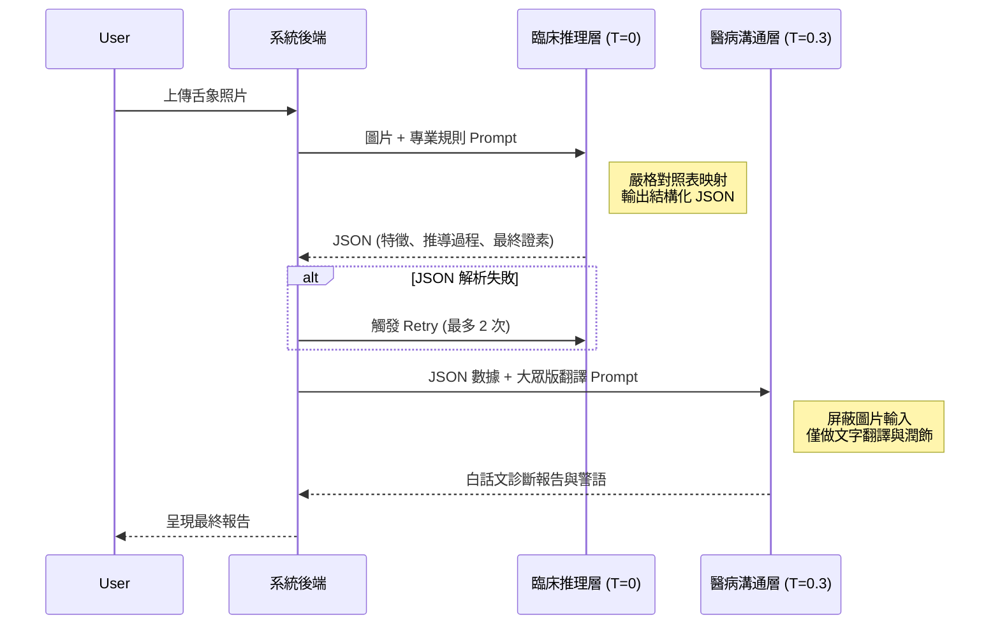

# 🔬 LLM Tuning TCM (中醫舌診參數調優框架)

這是一個基於非同步架構 (Async) 且具備嚴謹黃金標準驗證的 LLM 推理參數調優工具，專為中醫舌診場景設計。
透過 PRF1 指標與 Rule-based LLM 裁判的混合評分機制，調優產出的最佳參數，可直接匯回 [Tongue-Diagnosis 主應用](https://github.com/FJCU-AI-APPLICATION/Tongue-Diagnosis) 的設定中使用。

## 🎯 核心功能
- **非同步高併發 (Async Workflow)**：使用 `asyncio` 實作多 Worker 併發，大幅提升參數搜索效率，並支援斷點續傳。
- **混合評分與 PRF1 指標**：結合實體級 Jaccard 穩定性、Precision/Recall/F1 證素評分，以及 Rule-based LLM 裁判。
- **雙提示詞架構**：將「專業診斷推導」與「大眾白話翻譯」拆分，確保評分的科學性與客觀性。
- **自動化報告**：自動產生所有測試組合的 CSV 評分結果。

## 🖥️ 智慧舌診全端系統運行展示 (Full-Stack Showcase)

本專案結合前段深度學習特徵抽取與後段大型語言模型辨證，以下為臨床輔助診斷系統之實際運行畫面：

### 1. 系統即時操作展示 (Live Demo)
<div align="center">
  
  <p><i>▲ 終端操作即時錄影：正面舌象拍照上傳 ➔ 多任務 CNN 特徵分析 ➔ 雲端老中醫 Agent 智能辨證</i></p>
</div>

### 2. 端到端全端架構與拍照介面
| 端到端系統架構圖 (Vision + FastAPI + LLM) | 終端鏡頭即時拍照與上傳介面 |
| :---: | :---: |
|  |  |

### 3. 深度學習視覺模型表現 (CV Engineering)
- **Model A (PyTorch 10-Head CNN)**：同時預測舌色、舌質、舌態、苔質等 10 項特徵，經 100 輪訓練穩定收斂。
- **Model B (ONNX Sublingual)**：分層 5 折交叉驗證 (Stratified 5-Fold CV)，確保舌下絡脈異常（曲張/囊泡）精準檢出。

| Model A 10頭特徵預測與信心度長條圖 | Model A 100輪收斂戰績圖 | 舌質形態混淆矩陣 (對角線命中294例) |
| :---: | :---: | :---: |
|  |  |  |

### 4. LLM 臨床推理可解釋性與辨證論證 (Explainable AI)
- **五步病機因果論證**：徹底打破醫療 AI「黑箱診斷」，AI 自動列出對應表規則與因果演進鏈。
- **醫病雙向溝通**：同時兼顧臨床醫師專業報告與病患生活調養衛教（體質說明、禁忌食材、穴位按摩）。

| 雲端老中醫結構化體質診斷報告 | 臨床推理五步病機因果論證 (反幻覺白箱化) |
| :---: | :---: |
|  |  |

## 📁 專案結構
```text
.
├── assets/                  # 測試圖片與 ground_truth.json
├── prompts/                 # 提示詞存放區
│   ├── system_prompt_professional.md  # 專業臨床推導 (Stage 1 調優目標)
│   ├── system_prompt_layman.md        # 大眾白話翻譯 (Stage 2 醫病溝通)
│   └── judge_prompt.md                # LLM-as-a-Judge 評分提示詞 (含 Few-shot)
├── docs/                    # 研究文件與視覺展示素材
│   ├── research_notes/      # 提示詞優化與中醫理論審查備忘
│   └── showcase/            # 系統全端運作畫面、混淆矩陣與收斂曲線
├── evaluator.py             # 核心評測模組 (JSON 強健解析、PRF1、Jaccard 穩定性)
├── experiment_data/         # 實驗原始輸出與多輪推論數據紀錄
├── outputs/                 # 調優分析報表 (CSV) 與最佳參數配置
├── reports/                 # 階段性調優實驗報告 (如 2026-05-15 報告)
├── tuning_workflow_sync.py  # 第一代同步網格調優工作流
├── tuning_workflow_async.py # 第二代非同步高併發調優工作流 (斷點續傳)
├── requirements.txt         # 依賴套件清單
└── pyproject.toml           # 專案配置 (支援 uv 等工具)
```

## 🏗️ 雙層推論 Pipeline 架構 (Two-Stage Architecture)

本系統為確保中醫舌診的「醫療邏輯嚴謹性」與「終端用戶可讀性」，採用解耦的雙層推論架構。



### 架構優勢與錯誤隔離策略
1. **幻覺阻斷 (Hallucination Isolation)**：Stage 2 的模型無法存取原始圖片，從根本上杜絕了翻譯階段產生新的、與 Stage 1 矛盾的病理特徵。
2. **延遲優化 (Latency Control)**：Stage 1 輸出精簡 JSON，Token 數量極少（~3s）；Stage 2 可採用串流輸出（Streaming）直達前端（TTFB < 1s），整體體感延遲小於 4 秒。
3. **優雅降級 (Graceful Degradation)**：若 Stage 2 服務超時或當機，系統可直接渲染 Stage 1 的 JSON 數據作為「專業版報告」展示給用戶，避免服務完全中斷。

## 📊 實證調優成果與關鍵發現 (Empirical Benchmark & Findings)

本框架透過系統性網格搜尋（Grid Search），針對 3 種提示詞微調策略（醫生原版、思維鏈 CoT 版、極度精簡版）與 5 組超參數組合進行嚴格測試（詳見 [2026-05-15 實驗報告](reports/20260515_experiment_report.md) 與 [15組對照實驗數據表](outputs/doctor_sync_tuning_results.csv)）。

### 🏆 最佳生產環境配置 (Production Ready: EXP02)
- **提示詞**：`system_prompt_professional.md`（醫生 168 行對照表原文，無須額外干預）
- **超參數**：`Temperature = 0.0`, `Top-P = 0.9`
- **評測表現**：**診斷一致性 1.00 (完美)**、**術語覆蓋率 37.5% (全場最高)**、**綜合評分 4.10**

### 🔍 三大核心科學發現
1. **Temperature 的「死亡交叉」效應**：
   在強規則約束的中醫辨證場景下，**Temperature 從 0.0 提升至 0.1 即引發一致性斷崖式下跌**（從 1.00 跌至 0.23~0.54）。嚴格映射規則容不下任何隨機發揮，臨床推理層必須固定於 `T=0.0`。
2. **提示詞微調的負面效應 (Prompt Over-engineering)**：
   - **思維鏈 (CoT) 版**：強迫輸出推理過程反而擠佔了有限輸出空間，導致關鍵證素被大幅稀釋（平均術語覆蓋率僅 1.2%）。
   - **極度精簡版**：過度服從指令，導致模型省略了必備的病機邏輯分析。
   - **原版結構已自洽**：手寫的 168 行模組化規則已具備完整推導約束，過多額外指示反成干擾。
3. **Top-P 的詞彙增強效益**：
   在 `T=0.0` 確定性解碼下，較高的 `Top-P` (0.9) 允許模型在合法空間內選取更貼切豐富的中醫專業詞彙，術語覆蓋率比低 P 值 (0.1) 提升近一倍 (18.8% → 37.5%)。

## 🚀 快速上手

### 1. 安裝環境
需搭配 Python 3.11+。
```bash
# 使用 pip
pip install -r requirements.txt

# 或使用 uv (推薦)
pip install uv
uv pip install -r requirements.txt
```

### 2. 環境設定
複製範例環境檔並填入你的 API Key：
```bash
cp .env.example .env
# 編輯 .env 填入 GEMINI_API_KEY
```

### 3. 準備測試資料
1. **圖片**：請在專案根目錄建立 `assets/test_images/` 資料夾，並放入測試照片。若無，會 Fallback 使用 `assets/MyTongue.jpg`。
2. **黃金標準**：建立 `assets/ground_truth.json` 來定義每張圖片的正確證素標註。

### 4. 執行調優
```bash
# 執行最新非同步版本
python tuning_workflow_async.py

# 或使用 uv 執行
uv run tuning_workflow_async.py
```

### 5. 查看結果
執行完畢後，結果會儲存於 `outputs/` 目錄：
- `doctor_async_tuning_results.csv`：詳細的網格搜尋與評分紀錄 (支援中斷後接續執行)。

## 最新進度 (2026-05-19)

- **模組化與容錯升級**：建立獨立的 `evaluator.py` 模組，加入具備自動清除 Markdown 標籤與 Fallback Regex 功能的 Robust JSON 解析器，確保 F1 與一致性指標計算不受髒資料污染。
- **網格搜尋邏輯修正**：基於 LLM 解碼原理修正實驗網格，在 Temperature = 0 時固定 Top-P，剔除了無意義的重複實驗，大幅節省 API 成本與執行時間。
- **LLM Judge 校準 (Few-shot)**：建立獨立的 `prompts/judge_prompt.md`，加入明確的扣分規則與一正一反的 Few-shot 範例，解決評分趨中偏誤 (Central Tendency Bias) 的問題。
- **雙層 Pipeline 設計定案**：確認採用 `專業推理 (T=0) -> JSON -> 白話翻譯 (T=0.3)` 的二階段落地架構，徹底解決「術語覆蓋率 vs 語氣自然度」的衝突，並設計了對應的 Fallback 機制。

### 下一步驗證規劃 (SOP)
1. **GT 擴充**：採用分層抽樣，挑選 30-50 張涵蓋 9 種證素的圖片進行 Ground Truth 標註。
2. **人工盲測 (Human-in-the-loop)**：引入中醫師盲測，評估模型輸出的「診斷一致性」、「推導合理性」與「安全性」，並計算與 LLM Judge 的相關係數。
